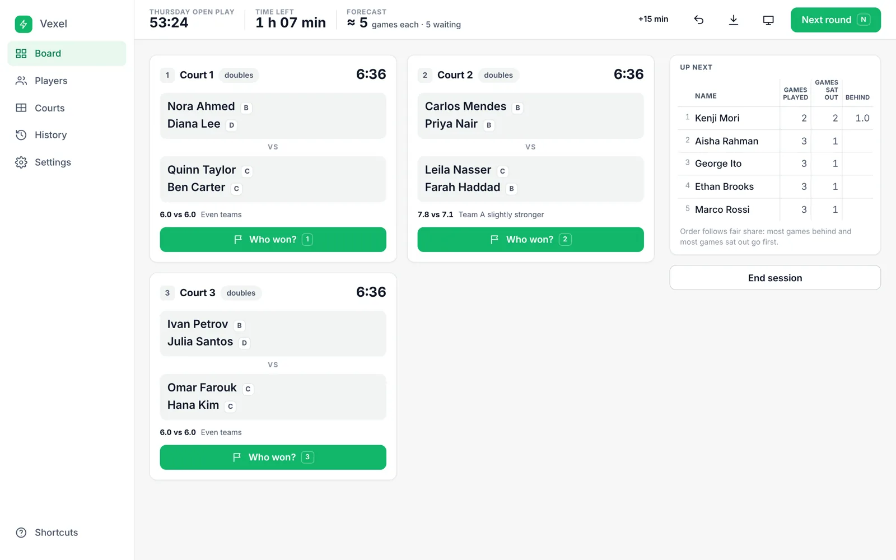
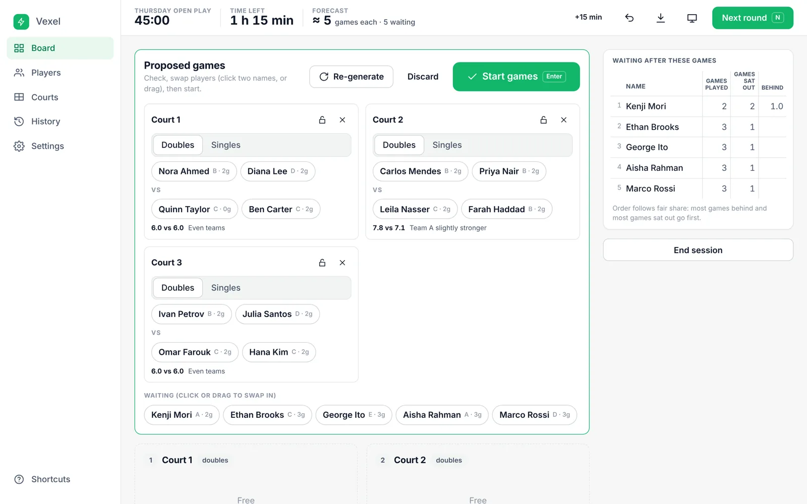
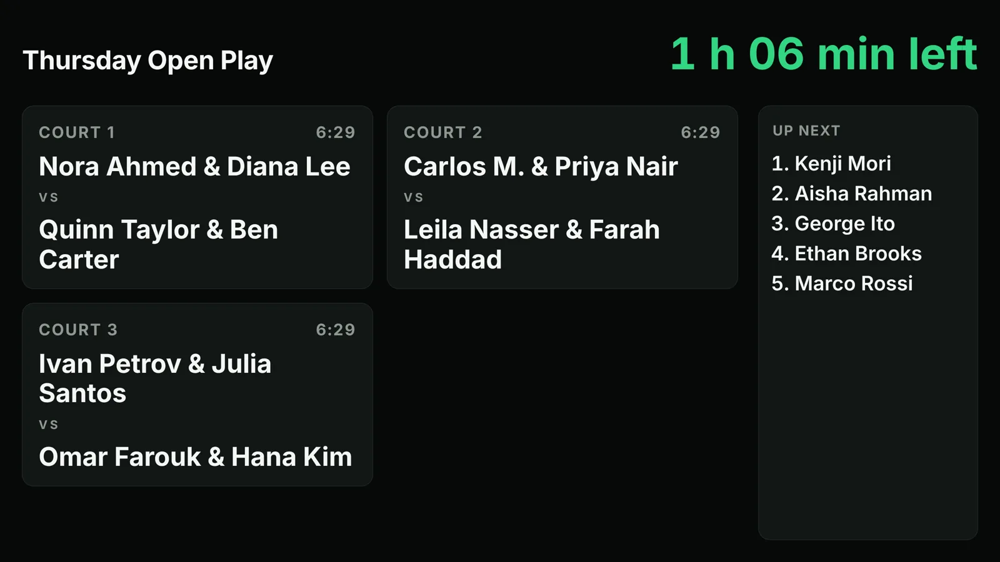
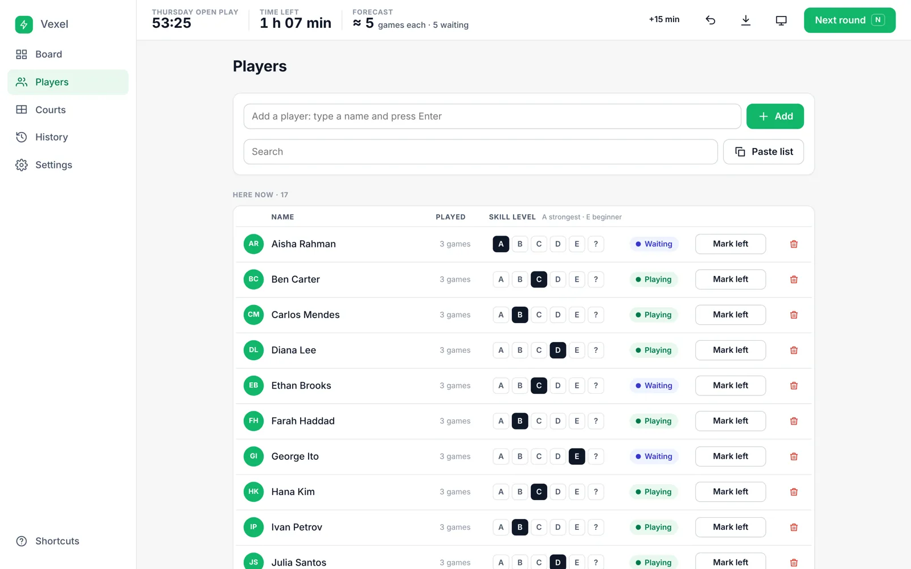
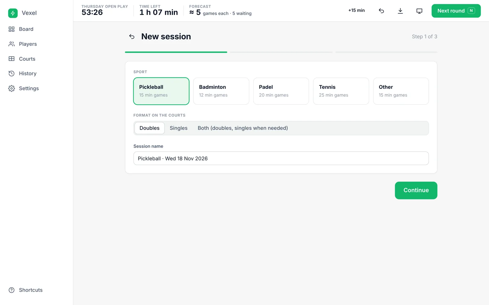
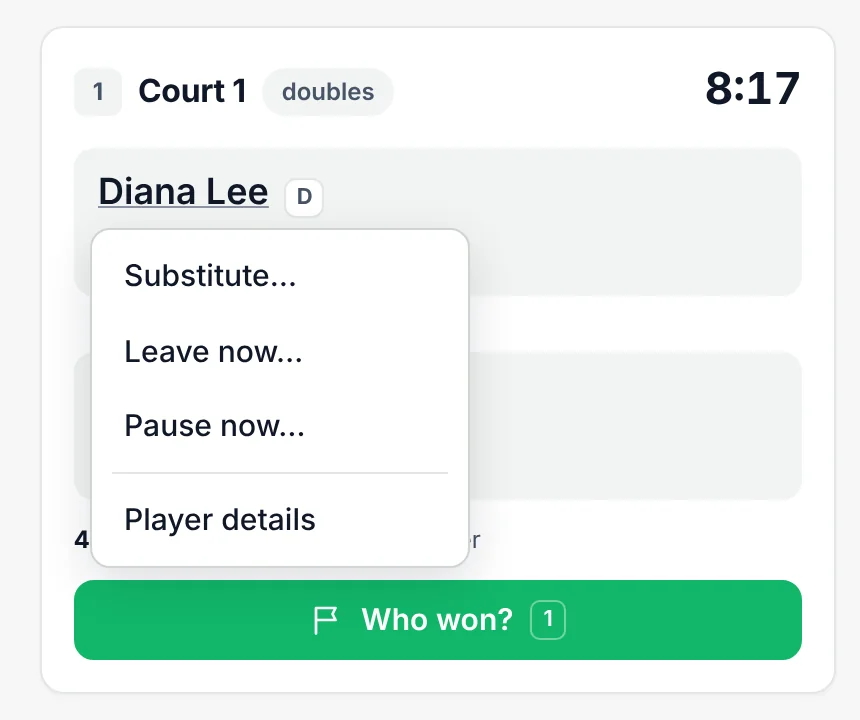
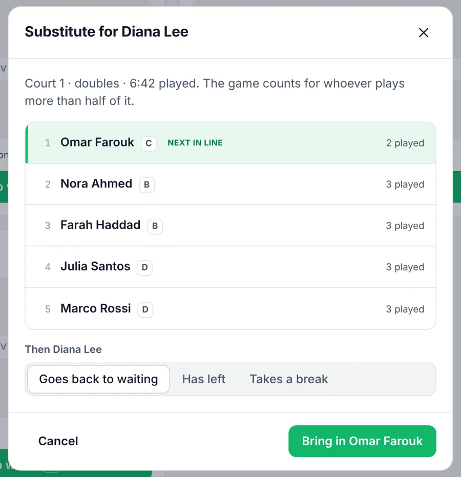
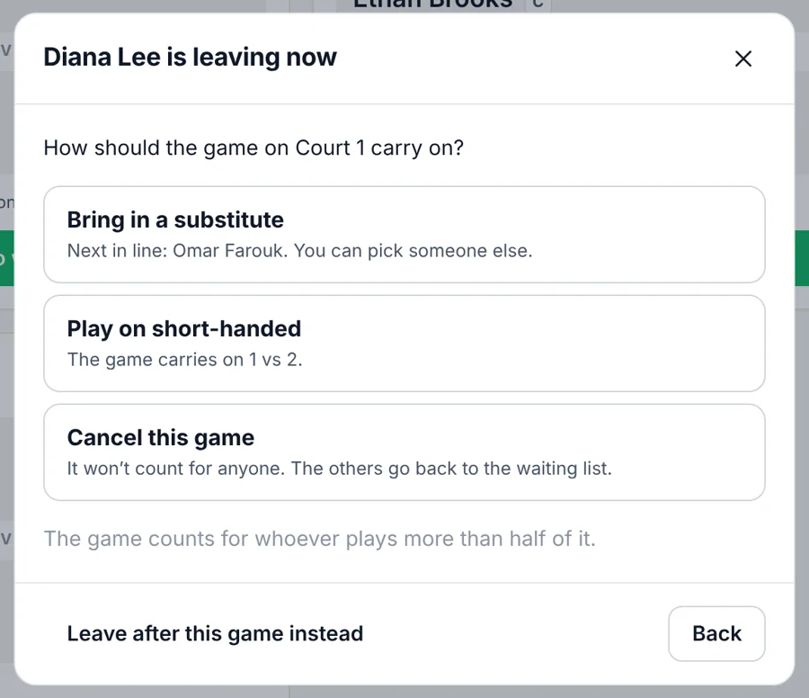
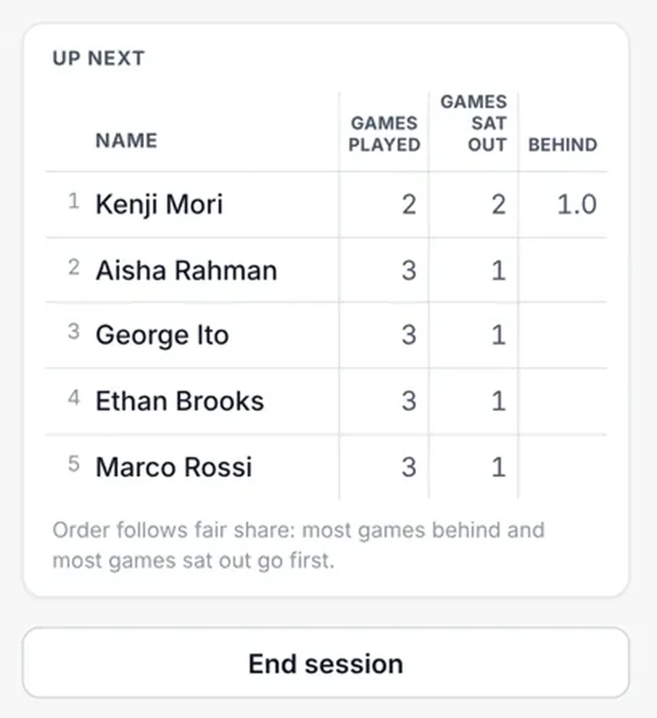
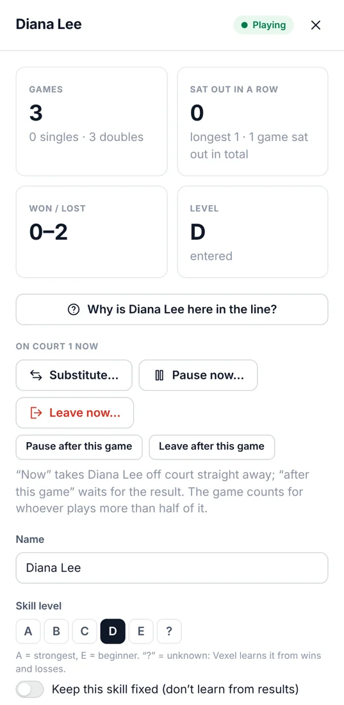

  

<h1 align="center">Vexel</h1>

  <b>Fair court rotation, without the arguments.</b> 
  For open play, club nights and casual tournaments.

  
  
  
  
  

  

Vexel decides who plays next, so everyone gets **equal games, fair waits and balanced teams**, even when people arrive late, leave early or take a break. You just tap who won.

**Pickleball · Badminton · Padel · Tennis · any singles or doubles court sport**

---

## Why Vexel

| The problem | What Vexel does |
|---|---|
| "Who's next?" The host ends up refereeing the queue. | Vexel fills every court automatically. When a game ends, the next one is ready. |
| Regulars get more games, newcomers wait longer. | Whoever is furthest behind their fair share plays next. Late arrivals get their share for the time they're there. |
| Strong players stack teams, same partners every game. | Skill levels A to E keep matches close, and Vexel avoids repeat teammates whenever it can. |

## Features

- **Equal games for everyone.** Nobody sits out twice in a row when it can be avoided.
- **Balanced teams.** Skill levels from A (strongest) to E (beginner). Don't know someone's level? Vexel learns it from who wins.
- **New partners every game.** Everyone mixes.
- **Any format.** Play to a score or timed games. Doubles, singles or both, with singles offered automatically when a few players would otherwise wait.
- **Late arrivals and early leavers.** Late players wait in line for their fair share; people who leave or take a break don't break the rotation.
- **TV display.** Plug in a TV or projector so everyone sees the courts, who's next and the time left.
- **Never loses a session.** Saved as you go, every action can be undone, and you can export a spreadsheet to finish on paper anytime.
- **No internet, no account.** Works fully offline. Updates install automatically when you're online.

## Screenshots

<table>
  <tr>
    <td width="50%"> <b>Check the next round, then start.</b> Swap players, switch a court to singles or lock a match. Team strength shown as numbers ("7.8 vs 7.0").</td>
    <td width="50%"> <b>A TV screen for the whole gym.</b> Courts, teams, time left and who's up next, readable from across the hall.</td>
  </tr>
  <tr>
    <td> <b>Check-in in seconds.</b> Add players, paste a whole list, set skill levels, pause someone or mark them as left.</td>
    <td> <b>Set up in a minute.</b> Pick the sport, courts and time. Vexel does the rest.</td>
  </tr>
</table>

### Tap any player for more options

<table>
  <tr>
    <td width="33%"> <b>Player menu.</b> Substitute, leave now, pause now or see details.</td>
    <td width="33%"> <b>Substitute mid-game.</b> Vexel suggests who's next in line, or you pick anyone.</td>
    <td width="33%"> <b>Someone has to leave?</b> Sub in, play on short-handed or cancel the game.</td>
  </tr>
  <tr>
    <td> <b>Up next.</b> Games played, games sat out and how far behind each player is. Clearly fair.</td>
    <td> <b>Player details.</b> Games, wins, losses, skill level and why they're where they are in line.</td>
    <td></td>
  </tr>
</table>

## Get started

1. **Download** `Vexel_<version>_x64-offline-setup.exe` from the [latest release](https://github.com/clisdan/vexel-releases/releases/latest).
2. **Install.** No admin rights and no internet needed. You can copy the installer to a USB stick.
3. **Run it** at your next session.

> If Windows shows "Windows protected your PC", click **More info → Run anyway**.

---

This repository hosts the Vexel website, installers and update files. Requires Windows 10 or 11 (64-bit). © 2026 Vexel
